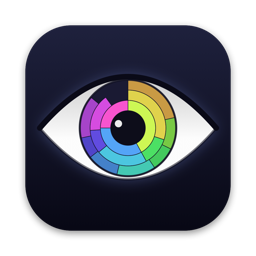
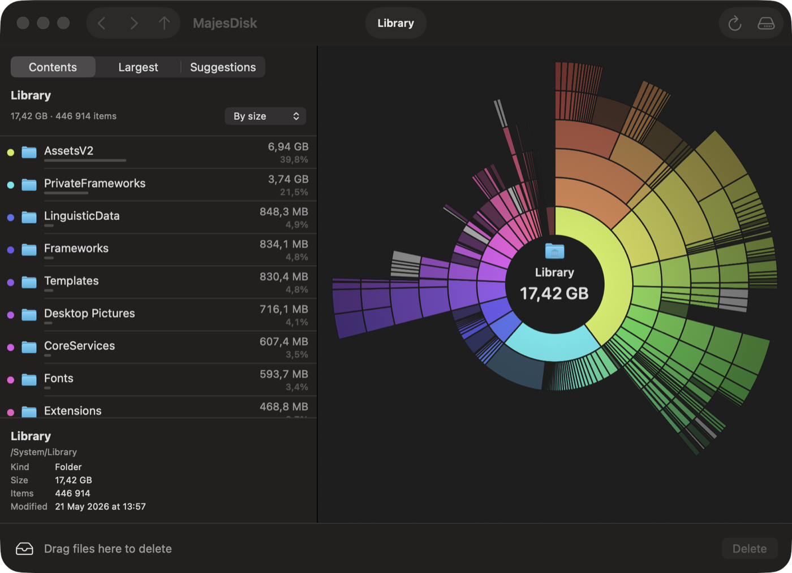
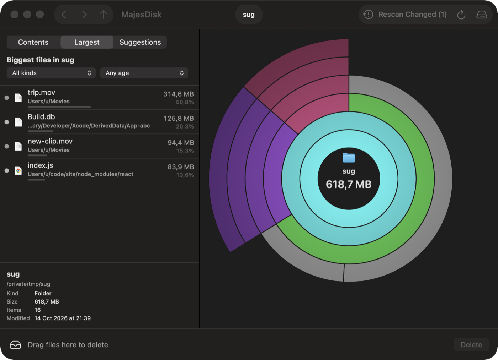
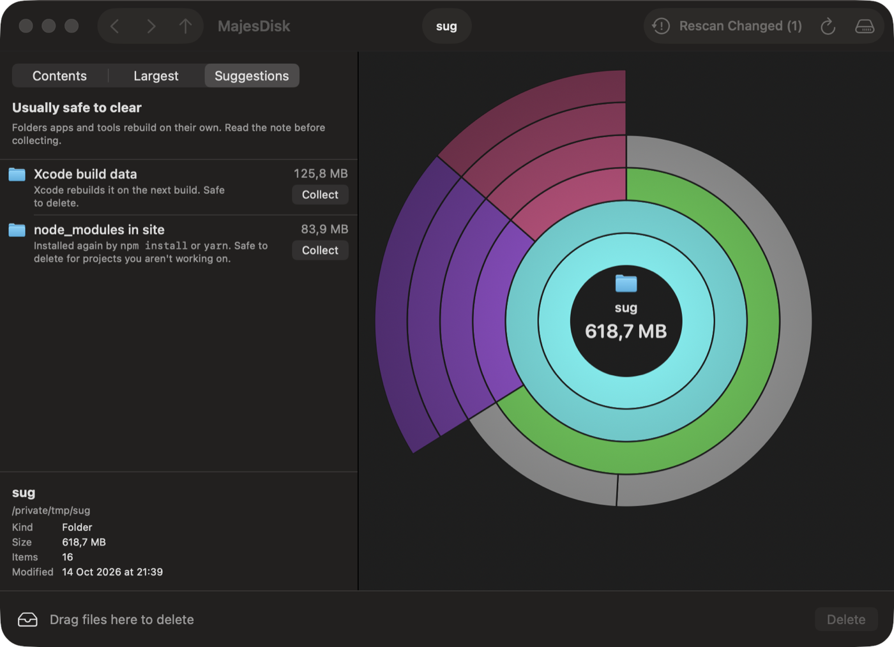
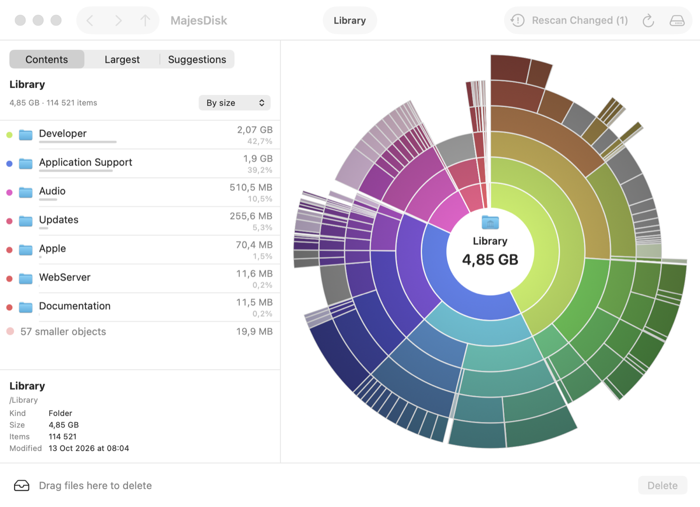

<div align="center">



# MajesDisk

**See what's filling your Mac, and clear it safely.**
A free, open-source, fully local disk analyzer for macOS, in the spirit of DaisyDisk.

[](LICENSE)




</div>

## Why tho??

- **Fast.** Reads folders in bulk with `getattrlistbulk` on parallel threads. About 1.3 million files take ~40 seconds on an SSD, and 200k files in a couple of seconds.
- **Honest numbers.** It counts the space files really take on disk. Hard links and APFS clones are counted once, and space the scan can't see is shown as *Hidden space*, split into purgeable space, other volumes and the rest.
- **Safe to clean.** Nothing is deleted until you press Delete and a 5-second countdown runs out. System folders, account homes and volume roots are refused, by the app and again by its admin helper.
- **Private.** No network access, no analytics, no account. Your scans stay on your Mac.
- **Free forever.** GPL-3.0, so every copy and every fork stays free and open.

## What it does

**An interactive map of your disk.** Each ring is one level deeper, each wedge is as wide as it is big, and you click to go in or click the center to go back. Hover any wedge to see it in the sidebar, press Space for Quick Look, and drag anything onto the Collector at the bottom.

<table>
<tr>
<td width="50%"></td>
<td width="50%"></td>
</tr>
<tr>
<td><b>Largest.</b> The 200 biggest files anywhere under the current folder. Filter by kind (videos, archives &amp; disk images, apps) or by age (unchanged for 6 months or a year).</td>
<td><b>Suggestions.</b> Space hogs that tools rebuild on their own, such as Xcode build data, simulators, caches, iPhone backups, Docker, Trash and <code>node_modules</code>. Each comes with a note and a one-click Collect.</td>
</tr>
</table>

- **Remembers your scans.** Results reopen instantly after a relaunch, and a rescan shows what grew since last time (`+8.2 GB`), with a *By growth* sort.
- **Scans in the background.** Each scan runs in its own disk or folder row with a percentage and time left. Several can run at once while you keep working.
- **Notices outside changes.** Files deleted in Finder are struck out, changed folders are tagged, and *Rescan Changed* re-measures only those.
- **The disk overview.** A live gauge for every disk. Hold <kbd>⌥</kbd> to count purgeable space as used. Star the folders you scan often.
- **Scan as Administrator.** Measures other users' homes and root-only folders. It asks for your password once per scan and installs nothing.
- **Local snapshots and purgeable space.** List Time Machine snapshots and delete them, or drop *Purgeable space* on the Collector to reclaim it.
- **Native and accessible.** Dark and light mode, VoiceOver labels and Reduce Motion support. Multi-select with <kbd>⇧</kbd>-click.

<p align="center"></p>

## Install

There's no signed download yet, so build it from source. Xcode is **not** required: the Command Line Tools are enough.

```bash
xcode-select --install          # once, if you don't have the Command Line Tools
git clone https://github.com/yegorglz/Majesdisk.git
cd Majesdisk
scripts/build-app.sh release    # → dist/MajesDisk.app
open dist/MajesDisk.app
```

Requires macOS 14 Sonoma or later. Apple silicon and Intel are both supported.

## Permissions, in plain words

| Permission | Why MajesDisk needs it | How to give it |
|---|---|---|
| **Full Disk Access** | Without it, macOS hides Mail, Messages, Safari and other apps' data, so that space shows up as *hidden*. | System Settings › Privacy & Security › Full Disk Access › turn on MajesDisk, then relaunch. The app's banner has buttons for each step. |
| **Folder prompts** | Without Full Disk Access, macOS asks separately for Desktop, Documents, Downloads, and removable or network disks. | Click Allow, or grant Full Disk Access once instead. |
| **Administrator** (optional) | Only for *Scan as Administrator*, deleting root-owned files, purging, and deleting snapshots. | macOS asks for your password each time. Nothing stays installed: no daemon, no login item. |

MajesDisk is not sandboxed, because it has to read the whole disk. Builds signed without a fixed identity get a new one on every rebuild, so grant Full Disk Access again after rebuilding, or sign with your own certificate:

```bash
MAJESDISK_SIGN_IDENTITY="My Code Signing Cert" scripts/build-app.sh release
```

## Keyboard

| Keys | Action |
|---|---|
| <kbd>↑</kbd> <kbd>↓</kbd> · <kbd>Page Up</kbd> <kbd>Page Down</kbd> · <kbd>Home</kbd> <kbd>End</kbd> | Move through the current folder |
| <kbd>↩</kbd> · <kbd>⌘</kbd><kbd>↑</kbd> | Open the pointed folder · go to the enclosing folder |
| <kbd>⌘</kbd><kbd>[</kbd> · <kbd>⌘</kbd><kbd>]</kbd> | Back · forward |
| <kbd>Space</kbd> | Quick Look |
| <kbd>⌘</kbd><kbd>⌫</kbd> | Move to or from the Collector |
| <kbd>⌘</kbd>-click | Reveal in Finder |
| <kbd>⌘</kbd><kbd>R</kbd> · <kbd>⇧</kbd><kbd>⌘</kbd><kbd>R</kbd> | Rescan folder · rescan disk |
| Pinch in / out on the map | Enter / leave a folder |

## How deleting works

1. Drag items to the **Collector** (or press <kbd>⌘</kbd><kbd>⌫</kbd>, or click *Collect* on a suggestion).
2. Press **Delete**. A red ring counts down 5 seconds, and *Cancel* stops it. Leaving the screen cancels it too.
3. Items are deleted permanently by default, so the space is freed right away. Settings › General can switch to *Move to Trash*.

If something can't be deleted for lack of permission, MajesDisk offers *Delete as Administrator*. If a folder delete fails halfway, the app re-measures that folder so the map matches the disk again.

## Compared with DaisyDisk

| | DaisyDisk | MajesDisk |
|---|:---:|:---:|
| Price | Paid | **Free (GPL-3.0)** |
| Interactive ring map, Quick Look, Collector, hidden & purgeable space | ✓ | ✓ |
| Scan as Administrator | Installs a helper daemon | Asks each time, installs nothing |
| Largest files across all folders, with filters | — | ✓ |
| Cleanup suggestions with explanations | — | ✓ |
| Remembers scans · shows what grew | — | ✓ |
| Multi-select collect | — | ✓ |
| Cloud drives (Dropbox, Google Drive, OneDrive, Box) | ✓ | — |
| Snapshot size estimates | ✓ | — |

## Development

```bash
scripts/test.sh                   # Swift Testing suite (adds the Command Line Tools framework paths)
scripts/run.sh --scan ~/Downloads # debug build, opened straight into a scan
```

The code is a Swift package. `MajesCore` holds the scanner, file tree, deletion and privileges, all UI-free and unit-tested. `MajesMap` holds the ring-map geometry. `MajesDisk` is the SwiftUI and AppKit app, and `majes-helper` is the small command-line tool used for administrator actions. The design notes and the original research live in [`docs/superpowers`](docs/superpowers).

Debug builds accept `--snapshot <png>` (saves the app's own window), `--collect <path>`, `--delete-collected`, `--sidebar largest|suggestions` and `--debug-no-elevation`. These are for scripted UI checks; see `scripts/snapshot.sh`.

## Roadmap

- A signed and notarized download
- Cloud drive scanning
- A Windows version

Issues and pull requests are welcome.

## License

[GPL-3.0](LICENSE). You're free to use, study, share and change MajesDisk, and any version you distribute must stay free and open under the same terms.

---

<sub>MajesDisk is an independent project. It is not affiliated with or endorsed by DaisyDisk or Software Ambience Corp. "DaisyDisk" is a trademark of its owner.</sub>
